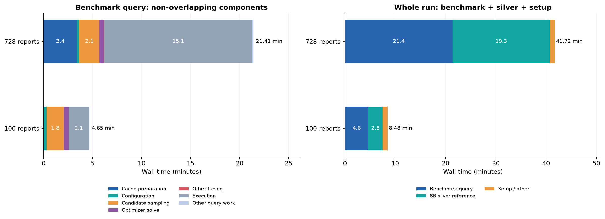
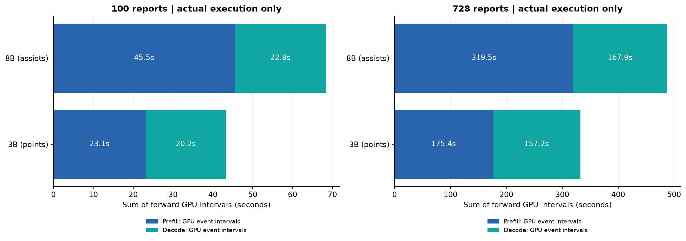
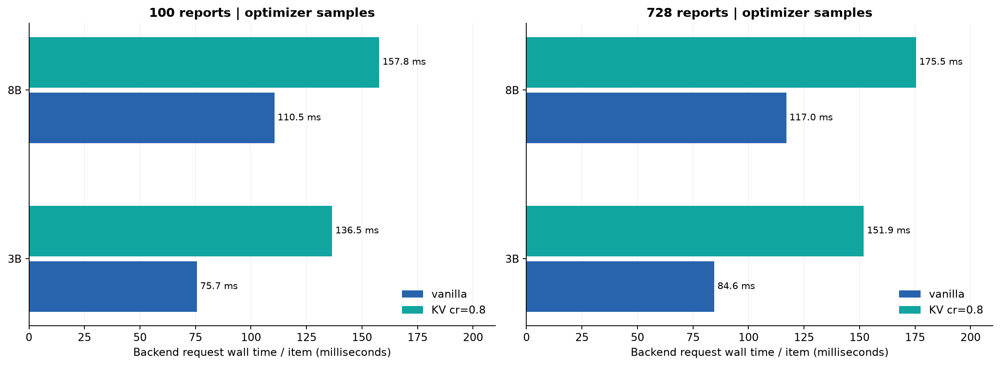
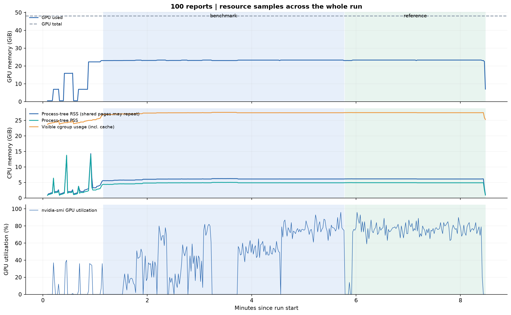
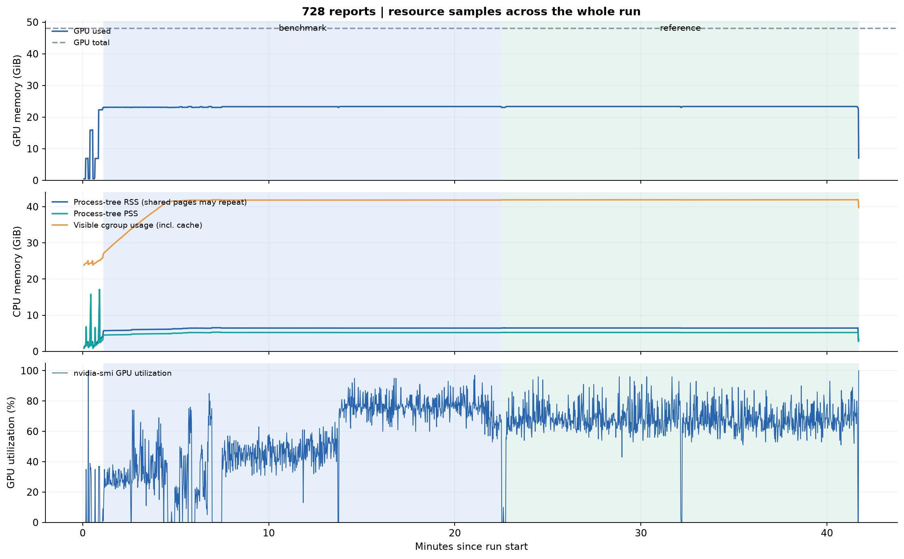
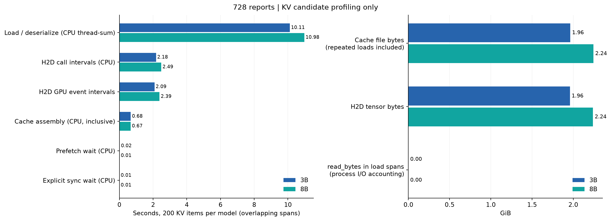
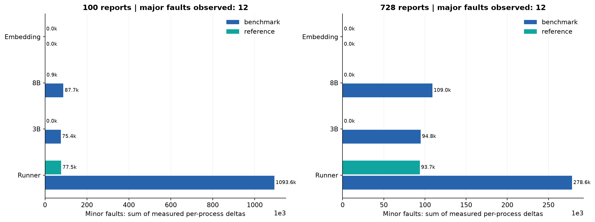
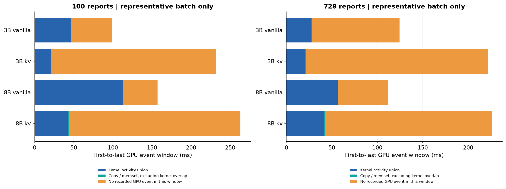
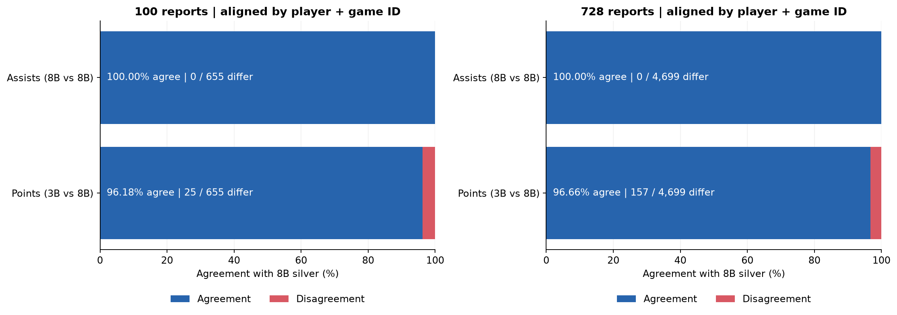
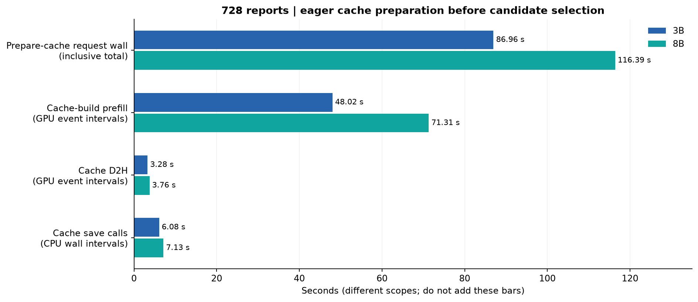

# Stretto 單卡 3B／8B：100 與 728 篇結果分析

| 指標 | 100 篇 | 728 篇 |
|---|---:|---:|
| 球員—報導結果列數 | 655 | 4,699 |
| 整輪含參考答案（分鐘） | 8.48 | 41.72 |
| benchmark 查詢（分鐘） | 4.65 | 21.41 |
| 正式 execution（分鐘） | 2.08 | 15.13 |
| GPU 採樣峰值（GiB） | 23.32 | 23.35 |
| 程序 RSS 加總峰值（GiB） | 14.29 | 17.12 |
| 可見 cgroup 使用峰值（GiB） | 27.59 | 42.00 |
| 對 8B silver 的 F1 | 0.9618 | 0.9666 |

## 主要發現

1. 完整 728 篇產生 4,699 列球員—報導組合，不是只問 728 個問題：每列都要抽 points 與 assists。正式 execution 實際呼叫 3B vanilla 抽 points、8B vanilla 抽 assists，各 4,699 items。計畫中雖保留 points 的 8B fallback，但 operator/backend 紀錄顯示這次沒有收到執行資料。

2. 728 篇的 benchmark 查詢 21.41 分鐘，其中 execution 15.13 分鐘（70.7%）；cache preparation 203.4 秒、候選採樣 123.0 秒、optimizer solve 28.2 秒。整輪 41.72 分鐘包含另外的 8B silver reference，不能全算成 benchmark 成本。

3. 正式 execution 的 forward GPU intervals：prefill 合計 494.9 秒、decode 325.1 秒，prefill 佔兩者 60.4%。顯式 H2D＋D2H GPU intervals 合計僅 1.93 秒。就目前紀錄，時間主要落在模型 forward／生成路徑，沒有證據顯示正式執行被顯式 PCIe 搬送主導；但不能進一步聲稱是純 GPU 算力瓶頸。

4. 候選採樣中，3B 的 KV/vanilla 每 item 時間比為 1.80，8B 為 1.50，即 KV 反而較慢。正式 execution 兩輪都沒有 KV 呼叫。KV 省下的 prefill 並未使這次端到端候選請求更快；讀檔／反序列化、多筆 tensor 搬送與呼叫間隙是值得後續隔離測量的原因，尚未證明個別因果。

5. 728 篇在選定最終算子之前，已為兩模型各建立 728 篇的 cache，prepare request 共 203.4 秒，佔 benchmark 查詢 15.8%。其中 cache-build prefill 的 GPU intervals 為 3B 48.0 秒、8B 71.3 秒。這些 cache 確實供候選採樣使用，但本輪正式 execution 沒用到；之後可研究 cache 建立時機，不能直接把這段成本刪掉當作已取得的加速。

6. 728 篇整卡顯存採樣峰值 23.35 GiB；程序 RSS 加總峰值 17.12 GiB（含模型載入期），benchmark 階段 RSS 加總峰值為 6.56 GiB；可見 cgroup 峰值 42.00 GiB。這次 batch=1 有餘裕，不能由此保證 24GB 顯卡或更大 batch 能跑；RSS 可能重複計共享頁，cgroup 包含 cache，不能直接當模型本身 RAM。

7. 兩輪 KV 載入區間的程序 read_bytes 都是 0，代表有邏輯讀檔但沒有記錄到該區間的實體讀取計帳，符合 page cache 命中情況。因此現在不能把 cache_file_load 說成 SSD→CPU 的硬體傳輸時間，也無法估 SSD 頻寬。

8. 728 篇對 8B vanilla silver 的 precision／recall／F1 都為 0.9666（約 96.66%）。逐欄對齊後，points 有 157 列不同、assists 有 0 列不同，無缺值。這是列級結果一致性，不是人工標註正確率；precision=recall 是兩邊唯一結果列數相同，不代表兩個指標被獨立驗證。

9. 代表 trace 的 CUDA kernels 之間有明顯空隙，尤其 KV；這支持調查 batch=1 的框架／launch／同步與 cache 整理成本。Trace 是有額外開銷的首批樣本，且沒有 CPU 使用率紀錄，不能直接宣稱整場 CPU-bound 或用這四批推估全場 GPU idle 比例。

10. 資料量由 655 列增至 4699 列（7.17 倍），正式 execution 時間增加 7.28 倍；每列約 0.190→0.193 秒。這兩點顯示目前正式執行大致隨結果列數增加，但單次兩點不能建立普遍的 scaling law。

## 圖表

### 實驗時間：查詢與整輪要分開看

左圖扣除 tuning 的子階段，避免重複加總。Cache preparation 是 /prepare_caches 的請求時間；其他工作是剩餘時間，未細分原因。右圖包含另外產生 8B 參考答案的時間。100 篇沒有重新建立 cache；728 篇有，因此不是相同 cold/warm 條件。

### 正式執行的 prefill／decode

只取 stage=benchmark、phase=execution；兩模型各處理一次每個球員—報導組合。GPU event interval 包含 launch gaps，不能稱為純計算時間。此次答案很短，通常只有一個 decode forward；不要與長文生成直接類比。

### 候選方案：KV 在本次採樣較慢

每模型每路徑兩個 request、合計 200 items（points 與 assists 各 100）；圖為總 request wall／總 items，不是每 token 吞吐。包含少量首批 trace 開銷與不同快取狀態，不能推論所有資料或 batch size 都如此。正式 execution 沒有 KV 請求。

### 100 篇：顯存、RAM 與 GPU 使用率

背景藍色為 benchmark、綠色為 reference。約一秒採樣會漏掉瞬間峰值；顯卡 utilization 不是 SM occupancy。RSS、PSS、cgroup 是不同口徑，不能相加；cgroup 包含 page cache 等，主機 RAM 可能含其他租戶。

### 728 篇：顯存、RAM 與 GPU 使用率

背景藍色為 benchmark、綠色為 reference。約一秒採樣會漏掉瞬間峰值；顯卡 utilization 不是 SM occupancy。RSS、PSS、cgroup 是不同口徑，不能相加；cgroup 包含 page cache 等，主機 RAM 可能含其他租戶。

### KV 搬送：讀檔不等於 SSD 實體讀取

左圖各量測區間可能包含或重疊，不可相加成總時間。右圖 cache 檔案量含重複載入，不是唯一 cache 大小；read_bytes 是載入區間的程序 I/O 計帳，全部為 0，符合 OS page cache 命中的情況，不能據此估 SSD 頻寬。

### Linux 缺頁：minor 與 major 分開解讀

按 PID＋建立時間使用每次採樣的增量，不加總累計值，也不再疊加 thread/request 的重複計數。第一筆／最後一筆之外的活動未涵蓋，跨 stage 邊界增量歸給後一個樣本。minor fault 不等於讀 SSD；這不是 CUDA Unified Memory faults。

### 代表 trace：GPU 區間不等於純 kernel 計算

以 trace 中第一個至最後一個 GPU event 作窗口，對 kernels／copies 取時間聯集，排除重疊。橘色表示此窗口沒有記錄到 GPU 工作，不等同已證明 CPU 是瓶頸。Trace 本身有開銷，且 small_kv 來自 configuring、其他來自 optimizer profiling，不能外推全場。

### 答案差異：points 與 assists 分別核對

由原始 CSV 以 name＋game_id 對齊，將數值 12 與 12.0 視為相同；此次鍵值唯一且無缺值。8B 參考答案也可能出錯，所以這是模型間一致性，不是人工標註準確率。差異明細另存 answer_differences.csv。

### 先建立 cache 的成本：兩模型共約 203 秒

728 篇各模型實際出現 728 個 cache_build_prefill；100 篇此次沒有新建 cache 的 span。Prepare request 包含其餘子工作，所以不可再加上 prefill／D2H／save。Cache save 是寫入呼叫時間，不代表資料已落到實體 SSD；這些 cache 有用於候選採樣，但正式 execution 最後沒有選 KV。

## 量測限制

- 本次只測上游固定 Rotowire 的一個 join＋兩個抽取查詢，並非整篇論文的所有 benchmark。3B/8B 單張 RTX 6000 Ada、BF16、batch=1，不能直接與原論文硬體／模型設定比較。

- 100 篇沿用已存在的 cache；728 篇在查詢中實際建立兩模型各 728 份 cache。整個 cache 目錄大小也含先前實驗，不能當本輪新增量。

- phase=profiling 是 optimizer 的候選資料採樣；run action=profile 才是這次打開的儀器量測模式，兩者名稱相近但含義不同。

- Prefill input_tokens 依實際 forward 計算；cached_query_prefill 只計補算，不等於整篇報導重新 prefill。生成紀錄 kind=generation 與 span name=generation 是同段工作，不能加兩次。

- 每秒資源採樣可能漏峰值；fault/I/O 增量排除 first_sample，跨階段增量依樣本結束 stage 歸類。數值為觀測範圍內，不是整個程序生命週期總量。

- 主機 RAM 約 503.5 GiB、可見 cgroup limit 約 197.3 GiB，與先前租借介面數字不同；只報告觀測口徑，不視為租用保證容量。

- 沒有 Nsight Unified Memory faults，沒有未開 profiling 的同條件 baseline，沒有重複試驗；不能報 profiling overhead、統計顯著性或對論文的 speedup。8B silver 僅是參考流程，cache／查詢設定與執行順序不同，不能直接當公平效能 baseline。

## 下一步

先用這份結果建立 baseline。若再租 GPU，優先在相同 warm-cache 條件下比較 run/profile 的重複試驗，並把 vanilla／KV 的同一批問題固定下來；再獨立測試 cache load、tensor copies 與 generation，以驗證 KV 較慢的原因。Nsight 與 batch-size sweep 是後續獨立實驗，不要混成這次已觀測的結論。

圖表可用 charts.pdf 分享，PNG 放投影片，SVG 保留向量。overview.csv、phase_spans.csv、requests.csv、resource_samples_*.csv、linux_faults.csv、trace_intervals.csv 與 analysis_summary.json 保存衍生數據；原始結果不修改。
